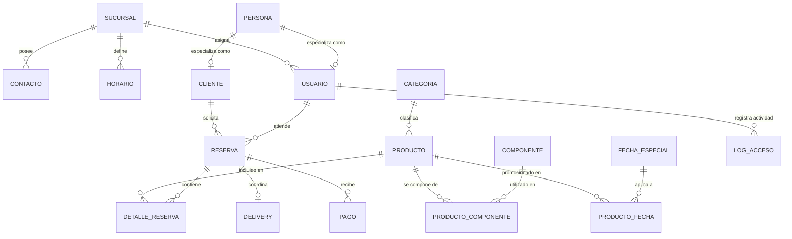
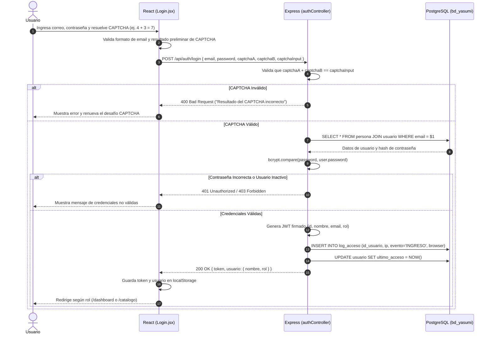
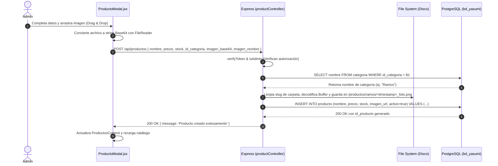

# 🌸 Informe Técnico y Funcional Exhaustivo: Sistema de Ventas "Yasumi"
> **Proyecto:** Sistema Integral de Ventas, Catálogo, Inventario y Seguridad — *Yasumi (Florería & Regalos)*  
> **Ubicación del Documento:** Raíz del Workspace (`sistema de ventas/INFORME_SISTEMA_VENTAS_YASUMI.md`)  
> **Fecha de Elaboración:** Octubre 2026  
> **Estado:** Auditoría y Análisis Completo de Código Fuente  

---

## 📋 Tabla de Contenidos
1. [Resumen Ejecutivo y Visión General](#1-resumen-ejecutivo-y-visión-general)
2. [Arquitectura General del Sistema](#2-arquitectura-general-del-sistema)
3. [Ecosistema Tecnológico y Dependencias](#3-ecosistema-tecnológico-y-dependencias)
4. [Análisis a Profundidad del Backend (`back-seguridad-main`)](#4-análisis-a-profundidad-del-backend-back-seguridad-main)
   - 4.1. Estructura del Proyecto
   - 4.2. Base de Datos Relacional y Modelo de Datos PostgreSQL
   - 4.3. Capa de Seguridad, Autenticación y Criptografía
   - 4.4. Controladores y Lógica de Negocio
   - 4.5. Catálogo de Rutas y Endpoints API REST
   - 4.6. Servicios y Módulos de Utilidad
5. [Análisis a Profundidad del Frontend (`front-seguridad-main`)](#5-análisis-a-profundidad-del-frontend-front-seguridad-main)
   - 5.1. Estructura del Proyecto y Bundling
   - 5.2. Gestión del Estado Global y Contextos
   - 5.3. Sistema de Rutas y Control de Acceso por Roles (RBAC)
   - 5.4. Páginas y Componentes de la Interfaz de Usuario
   - 5.5. Manejo de Multimedia, Subida de Imágenes y Drag & Drop
   - 5.6. Business Intelligence y Generación de Reportes PDF
6. [Mecanismos de Seguridad y Auditoría Implementados](#6-mecanismos-de-seguridad-y-auditoría-implementados)
7. [Flujos Operativos y Diagramas de Secuencia](#7-flujos-operativos-y-diagramas-de-secuencia)
8. [Matriz de Roles y Permisos](#8-matriz-de-roles-y-permisos)
9. [Conclusiones y Recomendaciones de Mejora](#9-conclusiones-y-recomendaciones-de-mejora)

---

## 1. Resumen Ejecutivo y Visión General

El sistema **Yasumi — Florería & Regalos** es una solución web integral diseñada para la administración comercial, gestión de inventario, catálogo interactivo de ventas y control de acceso con auditoría de seguridad. El sistema aborda las necesidades comerciales de una tienda de regalos, arreglos florales y pastelería fina personalizada, ofreciendo dos frentes principales:

1. **Frente Público / Cliente:** Un catálogo responsivo, interactivo y moderno que permite a clientes e invitados explorar colecciones, filtrar por categorías de productos (Ramos, Plantas, Decoración, Sets Especiales, Bocaditos, Tortas Personalizadas), visualizar disponibilidad de existencias y canalizar compras de forma directa mediante enlace integrado a **WhatsApp Business**.
2. **Frente Administrativo y Operativo (Backoffice):** Panel de control (Dashboard) con métricas clave de inventario en tiempo real, gestión completa de productos (CRUD con baja lógica y procesamiento de imágenes), administración de cuentas de usuario con roles diferenciados, gráficos estadísticos y un módulo de auditoría de accesos con capacidad de exportación a documentos PDF formales.

El sistema se compone de dos aplicaciones desacopladas: una API RESTful desarrollada en **Node.js** con **Express 5** y base de datos **PostgreSQL**, y una Single Page Application (SPA) construida con **React 18** y empaquetada mediante **Vite**.

---

## 2. Arquitectura General del Sistema

El sistema implementa una arquitectura desacoplada basada en el paradigma **Cliente-Servidor (Client-Server Architecture)** sobre protocolo HTTP/HTTPS:

```
┌────────────────────────────────────────────────────────┐
│                   Cliente (Frontend)                  │
│       React 18 + Vite (Puerto por defecto: 5173)      │
│  - React Router DOM v6 (Guardias de Rutas y RBAC)      │
│  - AuthContext & ProductosContext (Estado Global)      │
│  - Axios Client (Interceptors con Bearer JWT)          │
│  - Chart.js (Visualización de datos)                  │
│  - jsPDF + AutoTable (Reportes descargables)           │
└───────────────────────────┬────────────────────────────┘
                            │
               Peticiones REST (JSON / HTTP)
               Headers: Authorization: Bearer <Token>
                            │
┌───────────────────────────▼────────────────────────────┐
│                   Servidor (Backend)                  │
│     Node.js + Express 5 (Puerto por defecto: 3002)     │
│  - Middlewares: CORS, verifyToken, isAdmin, validate   │
│  - Controladores y Validadores (express-validator)     │
│  - Servicios Transaccionales (pg withTransaction)      │
│  - Seguridad: Bcryptjs, JWT, CAPTCHA matemático        │
│  - Procesador de Imágenes Base64 a Disco Local         │
└───────────────────────────┬────────────────────────────┘
                            │
                   Pool de Conexiones (pg)
               Consultas Parametrizadas ($1, $2...)
                            │
┌───────────────────────────▼────────────────────────────┐
│              Base de Datos (PostgreSQL 14+)            │
│  - bd_yasumi (17 tablas normalizadas)                  │
│  - Integridad referencial con llaves foráneas (FK)     │
│  - Auditoría de accesos (log_acceso)                   │
│  - Reservas, pagos, entregas y detalles comerciales   │
└────────────────────────────────────────────────────────┘
```

---

## 3. Ecosistema Tecnológico y Dependencias

### 3.1. Backend (`back-seguridad-main`)
| Paquete | Versión | Rol en el Sistema |
|---|---|---|
| `express` | `^5.2.0` | Framework web base para routing, middlewares y gestión de peticiones HTTP. |
| `pg` | `^8.23.0` | Cliente oficial de PostgreSQL para Node.js con pooling de conexiones y transacciones. |
| `jsonwebtoken` | `^9.0.2` | Generación y verificación de tokens de autenticación stateless (JWT). |
| `bcryptjs` | `^3.0.3` | Hashing criptográfico unidireccional y salting de contraseñas de usuarios. |
| `express-validator` | `^7.1.0` | Validación y sanitización rigurosa de datos de entrada en endpoints. |
| `cors` | `^2.8.5` | Configuración de Cross-Origin Resource Sharing con soporte de credenciales. |
| `dotenv` | `^17.2.3` | Inyección de variables de entorno desde archivos de configuración `.env`. |
| `nodemon` (dev) | `^3.1.11` | Recarga en caliente del servidor Node.js durante desarrollo. |

### 3.2. Frontend (`front-seguridad-main`)
| Paquete | Versión | Rol en el Sistema |
|---|---|---|
| `react` / `react-dom` | `^18.2.0` | Biblioteca declarativa de UI para interfaces basadas en componentes funcionales y Hooks. |
| `vite` | `^5.0.0` | Servidor de desarrollo ultrarrápido y empaquetador para producción (Rollup-based). |
| `@vitejs/plugin-react`| `^4.2.0` | Soporte para Fast Refresh de React en Vite. |
| `react-router-dom` | `^6.20.0` | Enrutamiento del lado del cliente con componentes de protección y redirección. |
| `axios` | `^1.17.0` | Cliente HTTP basado en promesas con interceptores globales para inyección de JWT. |
| `chart.js` | `^4.4.0` | Motor de renderizado en Canvas para visualizaciones estadísticas (Doughnut y Bar). |
| `jspdf` | `^2.5.1` | Generador del lado del cliente de documentos PDF en formato estándar A4. |
| `jspdf-autotable` | `^3.7.0` | Plugin para maquetación automática de tablas estructuradas dentro de jsPDF. |

---

## 4. Análisis a Profundidad del Backend (`back-seguridad-main`)

### 4.1. Estructura del Proyecto
El backend utiliza módulos estándar de ECMAScript (`"type": "module"` en `package.json`). Su árbol de archivos está organizado por responsabilidades claras:

```
back-seguridad-main/
├── db/
│   ├── base-datos.sql          # Versión histórica / esquema MariaDB
│   └── bd_yasumi_postgres.sql  # Script DDL/DML migrado y optimizado para PostgreSQL
├── src/
│   ├── config/
│   │   ├── db.js               # Conexión pg.Pool y helper transaccional withTransaction
│   │   ├── env.js              # Carga centralizada de dotenv
│   │   └── jwt.js              # Clave secreta y tiempo de expiración JWT
│   ├── controllers/
│   │   ├── authController.js   # Login, registro, invitado, logout
│   │   ├── categoryController.js # Listado de categorías activas
│   │   ├── logController.js    # Consulta de logs de acceso para auditoría
│   │   ├── productController.js# CRUD de productos, baja lógica y guardado de imágenes
│   │   └── userController.js   # Listado y alternancia de estado activo de usuarios
│   ├── middleware/
│   │   ├── authMiddleware.js   # verifyToken e isAdmin
│   │   └── validatorMiddleware.js # Interceptor de express-validator y evaluarFortaleza
│   ├── routes/
│   │   ├── authRoutes.js       # Rutas /api/auth
│   │   ├── categoryRoutes.js   # Rutas /api/categorias
│   │   ├── logRoutes.js        # Rutas /api/logs
│   │   ├── productRoutes.js    # Rutas /api/productos
│   │   └── userRoutes.js       # Rutas /api/usuarios
│   ├── services/
│   │   ├── logService.js       # Inserción de auditoría en log_acceso
│   │   └── userService.js      # Búsqueda y creación transaccional de usuarios
│   ├── utils/
│   │   ├── files.js            # Limpieza de slugs y directorios del frontend
│   │   ├── helpers.js          # Extractor de IP real, formateador de nombres y wrapper de errores
│   │   ├── imageGenerator.js   # Sincronización de imágenes transparentes en disco
│   │   └── roles.js            # Mapeador bidireccional de roles BD <-> Frontend
│   └── validators/
│       ├── authValidators.js   # Reglas de validación para login y registro
│       └── productValidators.js# Reglas de validación para alta y edición de producto
├── index.js                    # Inicializador de la aplicación Express
├── .env                        # Variables locales activas
└── .env.example                # Plantilla de configuración de entorno
```

### 4.2. Base de Datos Relacional y Modelo de Datos PostgreSQL
El esquema `bd_yasumi` en PostgreSQL fue adaptado para un modelo de datos robusto con un alto grado de normalización:



#### Descripción de Tablas Principales:
1. **`persona`**: Entidad base abstracta que almacena `nombre`, `paterno`, `materno` y `email` (único).
2. **`usuario`**: Extiende de `persona` con clave foránea `id_usuario = id_persona`. Contiene el `password` (hash de bcrypt), `id_sucursal`, `rol` (`'Administrador'`, `'Atención al Cliente'`, `'Cliente'`), flag `activo`, fecha de creación y `ultimo_acceso`.
3. **`cliente`**: Extiende de `persona` con `id_cliente = id_persona`. Almacena `telefono`, `direccion`, `fecha_nacimiento` y `fecha_registro`.
4. **`categoria`**: Catálogo de clasificación (`id_categoria`, `nombre`, `descripcion`, `imagen_url`, `activo`).
5. **`producto`**: Artículos comercializables (`id_producto`, `id_categoria`, `nombre`, `descripcion`, `tipo`, `imagen_url`, `precio`, `stock_disponible`, `stock_minimo`, `activo`).
6. **`log_acceso`**: Registro de auditoría forense (`id_log`, `id_usuario`, `ip_address`, `evento`, `browser`, `fecha_hora`).
7. **Módulos de Reserva, Pagos y Logística:** Tablas listas para el ciclo de venta formal: `reserva`, `detalle_reserva`, `delivery` (destinos y costo de flete), `pago` (métodos, comprobantes y estados de cobro), `componente` y `producto_componente` (receta de insumos), y `fecha_especial` / `producto_fecha` (descuentos estacionales como Día de la Madre o Navidad).

### 4.3. Capa de Seguridad, Autenticación y Criptografía
1. **Doble factor / Verificación CAPTCHA Matemático:**  
   En cada solicitud de login, el cliente debe resolver un desafío de adición generado aleatoriamente (`captchaA + captchaB`). El controlador verifica la operación aritmética en backend (`parseInt(captchaA) + parseInt(captchaB) === parseInt(captchaInput)`), impidiendo ataques de fuerza bruta automatizados o ataques de diccionario.
2. **Criptografía de Contraseñas (Bcrypt):**  
   Las contraseñas no se almacenan nunca en texto plano. En el registro se procesan con `bcrypt.hash(password, 10)`. En el inicio de sesión, `bcrypt.compare` verifica el hash salteado.
3. **Algoritmo de Evaluación de Fortaleza:**  
   En `src/middleware/validatorMiddleware.js`, la función `evaluarFortaleza` comprueba:
   - Longitud mínima de 6 caracteres.
   - Presencia de mayúsculas, minúsculas, números y caracteres especiales.
   - Calificación en tres niveles: `'debil'`, `'media'`, `'fuerte'`. El sistema rechaza contraseñas con nivel débil en el registro.
4. **JSON Web Tokens (JWT) Stateless:**  
   Tras un inicio de sesión válido, se firma un token con `JWT_SECRET` conteniendo la carga útil:
   ```json
   {
     "id": 1,
     "nombre": "Carlos Mendoza",
     "email": "carlos.m@example.com",
     "rol": "admin"
   }
   ```
   - Expiración estándar: `8h`.
   - Expiración de cuenta invitado: `2h`.
5. **Mapeo de Roles:**  
   La utilidad `src/utils/roles.js` estandariza los roles de base de datos a códigos en minúsculas usados por el frontend:
   - `'Administrador'` → `'admin'`
   - `'Atención al Cliente'` → `'vendedor'`
   - `'Cliente'` → `'cliente'`

### 4.4. Controladores y Lógica de Negocio
- **`authController.js`:**
  - `login`: Valida CAPTCHA, verifica existencia del usuario, valida flag `activo`, contrasta hash de clave, mapea rol, emite JWT, escribe en `log_acceso` el evento `'INGRESO'` y actualiza la columna `ultimo_acceso`.
  - `register`: Valida fortaleza, verifica unicidad del correo, cifra contraseña, detecta si el usuario emisor es administrador (para permitir otorgar roles `'admin'` o `'vendedor'`) o si es público (asignando por defecto rol `'Cliente'`), y ejecuta la creación atómica.
  - `loginInvitado`: Localiza o genera en base de datos al usuario virtual `invitado@yasumi.com`, registra evento de ingreso y entrega token temporal de 2 horas.
  - `logout`: Requiere autenticación; registra de forma explícita el evento `'SALIDA'` en `log_acceso`.
- **`productController.js`:**
  - `getProductos`: Devuelve todos los productos con joins a categorías, normalizando precios como números y mapeando emojis de respaldo si la imagen es nula.
  - `crearProducto` / `editarProducto`: Recibe parámetros del producto; si detecta una carga de imagen en base64 (`imagen_base64` e `imagen_nombre`), ejecuta `guardarImagenBase64` escribiendo el buffer binario en la carpeta pública del frontend (`/productos/<slug_categoria>/<timestamp>_<nombre_limpio>.<ext>`) y persiste la URL relativa en la base de datos.
  - `eliminarProducto` / `reactivarProducto`: Implementan **baja lógica** (`UPDATE producto SET activo = false/true WHERE id_producto = $id`), asegurando que ninguna relación histórica o reporte pierda consistencia relacional.
- **`userController.js`:**
  - `getUsuarios`: Recupera la nómina de usuarios con formato local de fechas bolivianas (`es-BO`).
  - `toggleActivo`: Invierte el valor booleano de `activo` en la tabla `usuario`, permitiendo al administrador deshabilitar accesos inmediatamente sin eliminar el registro.
- **`logController.js`:**
  - `getAccessLogs`: Retorna los últimos 150 registros de auditoría ordenados descendentemente por fecha/hora.

### 4.5. Catálogo de Rutas y Endpoints API REST

| Método | Endpoint | Middleware de Acceso | Descripción |
|---|---|---|---|
| `GET` | `/ping` | Público | Comprobación de salud del servidor y conectividad con PostgreSQL. |
| `POST` | `/api/auth/login` | `loginRules`, `validate` | Inicio de sesión con correo, clave y resolución de CAPTCHA. |
| `POST` | `/api/auth/registro` | `registroRules`, `validate` | Registro de nuevo usuario (cliente público o empleado si lo invoca admin). |
| `POST` | `/api/auth/invitado` | Público | Emisión de sesión temporal como Invitado (Guest). |
| `POST` | `/api/auth/logout` | `verifyToken` | Cierre de sesión y registro de auditoría de SALIDA. |
| `GET` | `/api/productos` | Público | Consulta de catálogo y productos para inventario. |
| `POST` | `/api/productos` | `verifyToken`, `isAdmin`, `productoRules`, `validate` | Creación de nuevo producto con soporte de carga de imagen. |
| `PUT` | `/api/productos/:id` | `verifyToken`, `isAdmin`, `productoRules`, `validate` | Actualización de atributos y existencias de producto. |
| `DELETE` | `/api/productos/:id` | `verifyToken`, `isAdmin` | Desactivación (baja lógica) de un producto. |
| `POST` | `/api/productos/:id/reactivar`| `verifyToken`, `isAdmin` | Reactivación de producto previamente deshabilitado. |
| `GET` | `/api/productos/sync-images` | `verifyToken`, `isAdmin` | Sincronización manual de imágenes en disco y enlaces de BD. |
| `GET` | `/api/categorias` | Público | Obtención de categorías activas para filtros y formularios. |
| `GET` | `/api/usuarios` | `verifyToken`, `isAdmin` | Listado integral de usuarios registrados. |
| `POST` | `/api/usuarios/:id/toggle` | `verifyToken`, `isAdmin` | Habilitación/Deshabilitación de cuentas de usuario. |
| `GET` | `/api/logs` | `verifyToken`, `isAdmin` | Consulta de bitácora de auditoría de accesos. |

### 4.6. Servicios y Módulos de Utilidad
- **`src/config/db.js` (`withTransaction`):** Abstrae la ejecución atómica mediante `client.query('BEGIN')`, callback ejecutor, `COMMIT` en caso de éxito y `ROLLBACK` en caso de error, liberando el cliente al pool en el bloque `finally`.
- **`src/services/userService.js` (`crearUsuarioCompleto`):** Aplica `withTransaction` para crear simultáneamente el registro en `persona`, el usuario en `usuario` y el registro de `cliente` (si aplica).
- **`src/utils/helpers.js` (`getClientIp`):** Extrae la dirección IP real inspeccionando `x-forwarded-for` (apto para balanceadores y proxies reversos NGINX/Cloudflare) o `req.socket.remoteAddress`, removiendo prefijos IPv6 (`::ffff:`).
- **`src/utils/imageGenerator.js` (`generarImagenesVacias`):** Se ejecuta al iniciar el servidor Express. Revisa los productos de la BD, detecta enlaces externos rotos o ficticios (`example.com`), actualiza la BD con rutas normalizadas locales y genera archivos PNG transparentes de 1x1 si faltasen en el disco del frontend, previniendo errores 404 en el renderizado de la UI.

---

## 5. Análisis a Profundidad del Frontend (`front-seguridad-main`)

### 5.1. Estructura del Proyecto y Bundling
El frontend está desarrollado bajo el estándar de componentes funcionales de **React 18** y gestionado con **Vite**.

```
front-seguridad-main/
├── public/                 # Recursos estáticos servidos directamente
│   └── productos/          # Imágenes de productos ordenadas por carpetas de categoría
├── src/
│   ├── api/
│   │   └── axiosConfig.js  # Instancia Axios con interceptor Authorization Bearer
│   ├── components/
│   │   ├── Icons.jsx       # Componentes SVG vectoriales limpios (sin dependencias externas pesadas)
│   │   ├── Navbar.jsx      # Barra de navegación adaptable según estado y rol del usuario
│   │   └── ProductoModal.jsx# Ventana modal para creación y edición de productos con Drag & Drop
│   ├── context/
│   │   ├── AuthContext.jsx # Proveedor de autenticación, sesión, logout y auditoría
│   │   └── ProductosContext.jsx # Proveedor de productos, categorías y KPIs de inventario
│   ├── pages/
│   │   ├── Catalogo.jsx    # Catálogo público/cliente con filtros y enlace a WhatsApp
│   │   ├── Dashboard.jsx   # Panel de control con métricas y accesos directos
│   │   ├── Login.jsx       # Vista dual de Login y Registro con CAPTCHA y medidor de seguridad
│   │   ├── Productos.jsx   # Tabla de administración de inventario con filtros y baja lógica
│   │   ├── Registro.jsx    # Componente alternativo de registro para nuevos empleados
│   │   ├── Reportes.jsx    # Gráficos Chart.js y exportador de documentos PDF (jsPDF)
│   │   └── Usuarios.jsx    # Administración de nómina de usuarios y conmutación de estado
│   ├── App.jsx             # Árbol de enrutamiento con react-router-dom y guardias
│   ├── index.css           # Sistema de diseño global con variables CSS personalizadas
│   └── main.jsx            # Punto de montaje del Virtual DOM de React
├── index.html              # HTML raíz de la aplicación Vite
├── vite.config.js          # Configuración de compilación con plugin de React
└── package.json            # Metadatos y dependencias del frontend
```

### 5.2. Gestión del Estado Global y Contextos
La aplicación no requiere librerías complejas como Redux, resolviendo el estado mediante la **React Context API**:

1. **`AuthContext` (`src/context/AuthContext.jsx`):**
   - Mantiene el estado del usuario activo (`usuario`) sincronizado con `localStorage` (`yasumi_usuario` y `yasumi_token`).
   - Expone las funciones `login`, `logout`, `registrarUsuario`, `loginInvitado`, `fetchLogs` y `esAdmin`.
   - Configura el cierre de sesión transparente invocando la API para registrar el evento `'SALIDA'` antes de limpiar el almacenamiento local.
2. **`ProductosContext` (`src/context/ProductosContext.jsx`):**
   - Centraliza la lista de `productos` y `categorias`, además del estado `loading`.
   - Expone métodos de mutación: `agregarProducto`, `editarProducto`, `eliminarProducto` (baja lógica) y `reactivarProducto`.
   - Calcula métricas y KPIs en memoria mediante la función `estadisticas()`:
     - Cantidad de productos activos.
     - Cantidad de productos inactivos.
     - Agrupación por categoría (`reduce`).
     - Valor total monetario del inventario en Bolivianos (`sum += precio * stock`).

### 5.3. Sistema de Rutas y Control de Acceso por Roles (RBAC)
En `src/App.jsx`, el enrutamiento está blindado mediante componentes de orden superior (Guardias):

```mermaid
flowchart TD
    Inicio[Usuario navega a la URL] --> AuthCheck{¿Está autenticado?}
    AuthCheck -- No --> LoginView[Muestra exclusivamente /login]
    AuthCheck -- Sí --> RoleCheck{¿Qué rol posee?}
    
    RoleCheck -- "invitado" o "cliente" --> ClientRoutes[Acceso restringido: SOLO /catalogo]
    RoleCheck -- "vendedor" --> StaffRoutes[Acceso a /dashboard y /catalogo]
    RoleCheck -- "admin" --> AdminRoutes[Acceso total: /dashboard, /catalogo, /productos, /reportes, /usuarios]
    
    ClientRoutes --> RedirectCat[Cualquier otra ruta redirige a /catalogo]
    StaffRoutes --> RedirectDash[Rutas no autorizadas redirigen a /dashboard]
    AdminRoutes --> AllowAll[Navegación completa habilitada]
```

- **`RutaPrivada`:** Redirige a `/login` si no hay sesión iniciada.
- **`RutaAdmin`:** Comprueba `esAdmin()`. Si un usuario con rol `vendedor` intenta ingresar manualmente a `/productos`, `/reportes` o `/usuarios`, es interceptado y redirigido a `/dashboard`.

### 5.4. Páginas y Componentes de la Interfaz de Usuario

#### A. Página de Autenticación (`Login.jsx`)
- **Interfaz unificada con selector por pestañas:** Permite conmutar instantáneamente entre *"Iniciar Sesión"* y *"Crear Cuenta"*.
- **Desafío CAPTCHA:** Genera dos enteros aleatorios entre 1 y 9. No permite el envío si no coincide el resultado.
- **Medidor visual de fortaleza:** En el registro, evalúa la contraseña en tiempo real y muestra una barra reactiva con colores y consejos (Débil, Media, Fuerte).
- **Acceso rápido como Invitado:** Botón especial que permite a cualquier visitante ingresar al catálogo sin crear una cuenta previa.
- **Credenciales sugeridas:** Para facilitar pruebas y evaluaciones académicas o de auditoría.

#### B. Catálogo Interactivo (`Catalogo.jsx`)
- **Buscador en tiempo real:** Búsqueda reactiva por nombre o descripción de producto.
- **Selector de Categorías:** Botones tipo *pills* que filtran por categoría seleccionada (*Todas*, *Tortas*, *Bocaditos*, etc.).
- **Selector de Ordenamiento:** Orden ascendente/descendente de precio y orden alfabético A-Z.
- **Venta directa vía WhatsApp:**  
  Cada tarjeta de producto cuenta con un botón **"Consultar"**. Al presionarlo:
  - Si el usuario es `invitado`, le notifica que debe registrarse o iniciar sesión formalmente.
  - Si es un usuario logueado, calcula el enlace universal de WhatsApp:
    `https://wa.me/59169802910?text=Hola,%20me%20gustaría%20consultar%20por%20el%20producto:%20<NombreProducto>`  
    abriendo la conversación en una pestaña nueva con el mensaje listo para enviar.

#### C. Panel de Control (`Dashboard.jsx`)
- Saludo personalizado con el primer nombre del usuario.
- Cuatro tarjetas métricas (KPIs): Total Activos, Valor del Inventario (Bs.), Categorías y Total Inactivos.
- Tarjetas interactivas de categorías destacadas con iconos vectoriales SVG.
- Cuadrícula de productos destacados con visualización de precio y stock.

#### D. Gestión de Productos (`Productos.jsx`)
- Tabla completa de inventario con vista previa de imagen en miniatura.
- Filtros cruzados simultáneos: por texto, por categoría y por estado (*Solo activos*, *Solo inactivos*, *Todos*).
- Alerta visual en color rojo cuando el stock llega a `0 (Agotado)`.
- Eliminación lógica mediante botón rojo de eliminación (que no borra la fila física de la base de datos) y botón verde de restauración.

#### E. Gestión de Usuarios (`Usuarios.jsx`)
- Lista de empleados y administradores con detalle de sucursal, rol asignado, fecha de creación y último ingreso registrado.
- Botón interactivo para **activar/desactivar** cuentas de acceso de manera instantánea.
- Modal de registro de nuevos colaboradores con selección de rol (`Administrador` o `Vendedor`).

### 5.5. Manejo de Multimedia, Subida de Imágenes y Drag & Drop
El componente `ProductoModal.jsx` incorpora una experiencia de usuario avanzada:
1. **Zona interactiva Drag & Drop:** Los administradores pueden arrastrar archivos de imagen directamente desde su explorador de archivos de Windows/Mac hacia la zona punteada del modal.
2. **Previsualización inmediata:** Hace uso de `URL.createObjectURL(file)` para mostrar de inmediato la imagen elegida sin demoras de red.
3. **Conversión Asíncrona Base64:** Mediante `FileReader`, la imagen se codifica a Base64 y se adjunta a la carga útil JSON.
4. **Almacenamiento Físico en Servidor:** El backend recibe el payload, crea los directorios jerárquicos según la categoría si no existieran (`ensureDir`), guarda el archivo físico con timestamp protector para colisiones y almacena la ruta relativa.

### 5.6. Business Intelligence y Generación de Reportes PDF
En `Reportes.jsx`, el sistema explota los datos comerciales en dos formatos:

#### 1. Gráficos Interactivos (Chart.js)
- **Gráfico de Dona (Doughnut):** Muestra la distribución porcentual de productos por cada categoría.
- **Gráfico de Barras (Bar Chart):** Comparativa visual de los precios unitarios de cada producto activo del catálogo.

#### 2. Generación Dinámica de Archivos PDF (jsPDF + autoTable)
La aplicación construye los PDFs enteramente en el navegador del cliente, evitando sobrecargar el CPU del servidor:

- **Reporte de Inventario:**
  - Encabezado institucional con paleta de color corporativa (`#B91C5C` - Rosa profundo).
  - Resumen ejecutivo con fecha/hora de emisión, totales de productos y valuación monetaria total en Bolivianos.
  - Tabla estilizada con filas alternadas (*striped rows*) conteniendo producto, categoría, precio unitario, stock y tipo.
  - Numeración dinámica de páginas en el pie (*Pág. X/Y*).
- **Reporte de Auditoría de Accesos:**
  - Estilizado con temática oscura de seguridad (`#0F172A` - Azul pizarra / Dark slate).
  - Desglose cronológico de los registros de `log_acceso`: Usuario, Dirección IP, Tipo de Evento (Ingreso/Salida), Agente de Navegación (Browser) y Timestamp.

---

## 6. Mecanismos de Seguridad y Auditoría Implementados

El sistema implementa defensas en profundidad frente a las principales vulnerabilidades comunes del Top 10 de OWASP:

| Vulnerabilidad / Riesgo | Mecanismo de Defensa Implementado | Ubicación en el Código |
|---|---|---|
| **Inyección SQL (SQLi)** | Consultas 100% parametrizadas mediante el cliente `pg` usando `$1, $2, ...`. Ninguna consulta concatena cadenas crudas del usuario. | `controllers/*.js`, `services/*.js` |
| **Robo de Contraseñas / Brechas** | Salting y Hashing criptográfico mediante `bcryptjs` con 10 rondas de complejidad algorítmica. | `authController.js`, `userService.js` |
| **Fuerza Bruta Automatizada (Bots)** | CAPTCHA matemático aleatorio evaluado forzosamente tanto en frontend como en el controlador backend. | `authController.js`, `Login.jsx` |
| **Contraseñas Débiles** | Función `evaluarFortaleza` que exige un mínimo de 6 caracteres con presencia obligatoria de números y letras en backend, complementada con feedback visual en frontend. | `validatorMiddleware.js`, `AuthContext.jsx` |
| **Acceso no Autorizado a Endpoints** | Middleware `verifyToken` que valida la firma criptográfica y la vigencia del JSON Web Token en cada petición protegida. | `authMiddleware.js`, `axiosConfig.js` |
| **Escalamiento de Privilegios** | Middleware `isAdmin` que restringe endpoints de administración en servidor, sumado a guardias `RutaAdmin` en React. | `authMiddleware.js`, `App.jsx` |
| **Denegación de Servicio por Fuga de Sesiones** | Tiempos de vida definidos para los tokens (8h para personal y 2h para invitados). | `config/jwt.js`, `authController.js` |
| **Pérdida de Trazabilidad e Integridad** | Registro persistente de IP y Navegador en cada inicio/cierre de sesión; uso de baja lógica (`activo = false`) en lugar de `DELETE` físico. | `logService.js`, `productController.js` |
| **Cross-Origin Resource Sharing (CORS)** | Configuración explícita de orígenes permitidos con soporte para cookies y headers de autorización. | `index.js` (backend) |

---

## 7. Flujos Operativos y Diagramas de Secuencia

### 7.1. Flujo de Autenticación con CAPTCHA y Emisión de JWT


### 7.2. Flujo de Guardado y Procesamiento de Productos con Imagen


---

## 8. Matriz de Roles y Permisos

| Módulo / Funcionalidad | Invitado (`invitado`) | Cliente (`cliente`) | Vendedor (`vendedor`) | Administrador (`admin`) |
|---|:---:|:---:|:---:|:---:|
| **Acceso a Catálogo de Productos** | ✅ Sí | ✅ Sí | ✅ Sí | ✅ Sí |
| **Búsqueda y Filtros de Productos** | ✅ Sí | ✅ Sí | ✅ Sí | ✅ Sí |
| **Consulta directa por WhatsApp** | ❌ Requiere cuenta | ✅ Sí | ✅ Sí | ✅ Sí |
| **Acceso a Panel Dashboard y KPIs** | ❌ No | ❌ No | ✅ Sí | ✅ Sí |
| **Creación / Edición de Productos** | ❌ No | ❌ No | ❌ No | ✅ Sí |
| **Eliminación / Reactivación de Productos** | ❌ No | ❌ No | ❌ No | ✅ Sí |
| **Subida de Imágenes Base64 a Disco** | ❌ No | ❌ No | ❌ No | ✅ Sí |
| **Visualización de Gráficos Estadísticos** | ❌ No | ❌ No | ❌ No | ✅ Sí |
| **Descarga de Reporte de Inventario en PDF** | ❌ No | ❌ No | ❌ No | ✅ Sí |
| **Visualización y Descarga de Logs de Auditoría**| ❌ No | ❌ No | ❌ No | ✅ Sí |
| **Gestión y Activación/Desactivación de Usuarios**| ❌ No | ❌ No | ❌ No | ✅ Sí |
| **Registro de Nuevos Empleados** | ❌ No | ❌ No | ❌ No | ✅ Sí |

---

## 9. Conclusiones y Recomendaciones de Mejora

### 9.1. Conclusiones
1. **Solución Robusta y Equilibrada:** El sistema **Yasumi** posee una arquitectura limpia, modular y desacoplada. Se encuentra perfectamente adaptado tanto para la venta rápida a través de mensajería moderna (WhatsApp Business) como para la gestión rigurosa de almacén y personal.
2. **Seguridad Bien Planteada:** La incorporación de CAPTCHA matemático sin librerías externas pesadas, validación de fortaleza de claves, uso de JWT, hashing mediante Bcrypt y registro exhaustivo de IPs y User-Agents en `log_acceso` proporcionan un estándar de seguridad sobresaliente.
3. **Escalabilidad de Datos:** La base de datos PostgreSQL cuenta con una estructura enriquecida que contempla sucursales, horarios, pagos, deliveries y componentes de insumos, permitiendo expandir las funciones del sistema en etapas futuras sin necesidad de rediseñar las tablas maestras.

### 9.2. Recomendaciones de Evolución Técnica
- **Subida de Archivos con Multer o Almacenamiento en Cloud:** Actualmente las imágenes se envían codificadas en Base64 directamente dentro del cuerpo JSON y se escriben en la carpeta del frontend. Si el catálogo crece a miles de productos, se aconseja migrar a subidas `multipart/form-data` con `multer` y almacenar los binarios en un bucket cloud (ej. AWS S3, Cloudinary o Google Cloud Storage).
- **Mapeo de Rutas del Flujo de Carrito / Ventas Directas:** Dado que las tablas `reserva`, `detalle_reserva` y `pago` ya se encuentran modeladas en la base de datos, se recomienda crear los endpoints en el backend y una interfaz de carrito de compras en el frontend para procesar órdenes dentro de la plataforma además del canal de WhatsApp.
- **Paginación en Servidor:** El endpoint `/api/productos` devuelve la totalidad de registros. Cuando el inventario supere los cientos de productos, es aconsejable implementar paginación basada en `LIMIT` y `OFFSET` o cursores en PostgreSQL.
- **Rotación y Refresh Tokens:** Implementar un esquema de `Refresh Token` con cookies `httpOnly` para evitar almacenar el JWT en `localStorage`, mitigando por completo cualquier vector residual de Cross-Site Scripting (XSS).

---
*Fin del informe. Documento generado para auditoría de código del proyecto Yasumi.*

